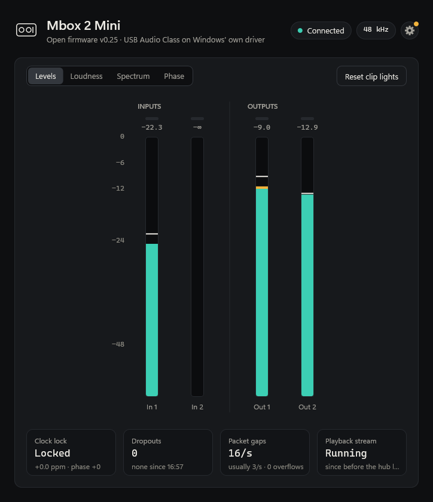
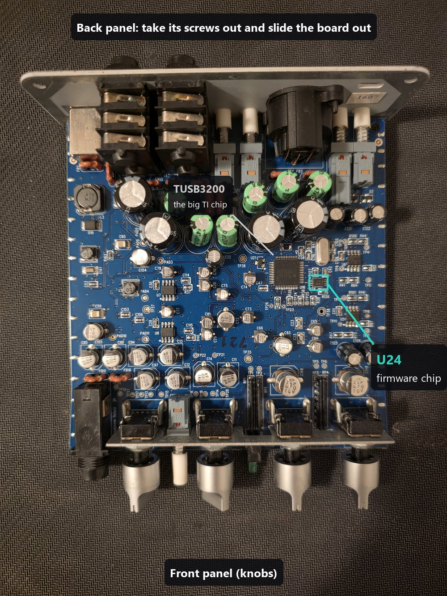
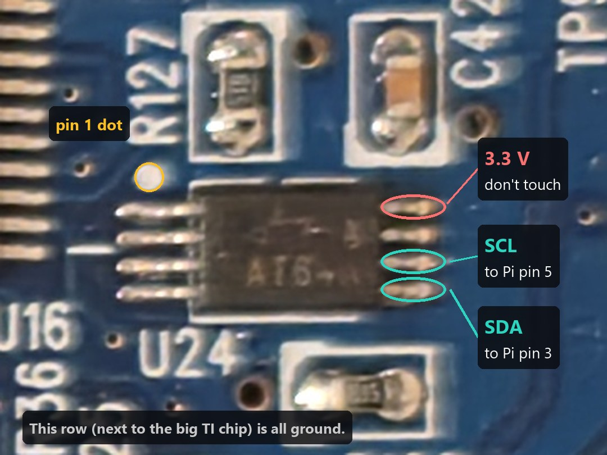
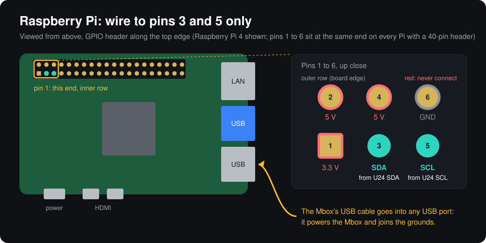

# Mbox 2 Mini open firmware

<a href="https://buymeacoffee.com/itsmeataco"></a>

If this brought your Mbox back to life, you can [buy me a coffee](https://buymeacoffee.com/itsmeataco).

New firmware for the Digidesign / Avid **Mbox 2 Mini** that turns it into a standard USB audio device, so it
runs on Windows 11's own built-in driver. No Avid driver, no blue screens, and Secure Boot and Memory
Integrity stay on. It comes with:

- **Mbox Hub**, a small tray app with meters, analysis, health monitoring and one-click updates
- **an ASIO driver** for DAWs such as Ableton Live, with low, accurately reported latency

You install the firmware once with a Raspberry Pi and two wires. After that, every update goes over USB.



## Why

Avid's last Mbox 2 driver dates from 2010 and is no longer supported. On Windows 11 it:

- only loads with **Memory Integrity turned off**, weakening the security of the whole PC;
- causes **blue screens** (power and USB request errors in its kernel driver);
- **goes silent** now and then while Windows still shows the device as working, until you replug it.

The hardware itself is fine. It's built around TI's TUSB3200A USB audio chip, which loads its firmware from a
small memory chip on the board at power-up. Replace that firmware and the driver problem goes away.

## What you get

**Open firmware**
- A standard USB Audio Class device: Windows installs it by itself as "Speakers (Mbox 2 Mini)" and
  "Microphone (Mbox 2 Mini)". It also works on Linux with no setup (tested on Raspberry Pi OS).
- Nothing to install in the kernel, so Secure Boot, driver signature enforcement and Memory Integrity all
  stay on.
- 24-bit playback and 16-bit recording at 44.1 or 48 kHz, with the clock locked to USB.
- Glitch-tested on Windows playing and recording at the same time: zero dropouts.
- Input 1 is left and input 2 is right, and Windows' AI noise suppression stays off (it would otherwise mix
  both inputs into one).

**ASIO driver**
- Lets DAWs that want ASIO (Ableton Live, Cubase, FL Studio, Reaper and others) use the Mbox directly.
- Runs entirely in user mode on top of Windows' own driver: no kernel code and no test signing.
- 13.5 ms measured round trip at a 144 sample buffer (48 kHz). That includes a fixed input safety margin
  of one buffer plus 1 ms, like a hardware interface's safety buffer. `InputMargin` = 0 (DWORD under
  `HKCU\Software\Mbox2Asio`) drops it for the lowest latency (9.8 ms), with less protection against glitches.
- Reports its latency to within a few samples of the measured round trip, so recordings line up without
  manual offset tweaking.
- Keeps that latency fixed for the whole session, also through glitches, so overdubs stay aligned in DAWs
  that only read it when they open the device, such as Ableton Live.

**Mbox Hub**
- Live input and output meters with peak hold and clip lights.
- Loudness (EBU R128 / LUFS, true peak, loudness range), spectrum and stereo phase analysis.
- Health at a glance: clock lock, dropouts and USB packet gaps, with a dropout log and tray notifications.
- **Reset converters** (firmware v0.27 and later, in the window and the tray menu): restarts the Mbox's DAC
  and ADC in about 40 ms, a first thing to try before replugging when the sound or the inputs go wrong.
- Checks GitHub for new releases, updates itself in one click, and installs new firmware over USB.
- Installs, updates and removes the ASIO driver, and sets its buffer size.
- Starts with Windows in the tray if you want it to. Uses about 0.5 % CPU there.

## Install

The first install has to write the firmware chip directly, because Avid's firmware won't accept ours over
USB. A Raspberry Pi does that through two wires. It takes about 30 minutes, most of it soldering,
and you only do it once.

### What you need

- An Mbox 2 Mini (the full-size Mbox 2 and the Mbox 2 Pro are different hardware and not supported)
- A Raspberry Pi with a 40-pin header (tested on a Pi 4B), a microSD card and the Pi's own power supply
- Two thin wires about 20 cm long (30 AWG wire-wrap wire is ideal), ideally with a female jumper plug on the
  Pi end
- A soldering iron with a fine tip, and a little flux
- A small Phillips screwdriver
- A Windows 11 PC

### 1. Set up the Pi

1. Put the microSD card in your PC and open [Raspberry Pi Imager](https://www.raspberrypi.com/software/).
2. Choose your Pi model, **Raspberry Pi OS Lite (64-bit)** (under Raspberry Pi OS (other)) and the card.
3. In the customisation steps, set a hostname (for example `mboxpi`), a username and password, your Wi-Fi,
   and turn on **SSH** with password login.
4. Write the card, put it in the Pi and leave the Pi off for now.

You don't need a screen or keyboard on the Pi: you'll run one command on it over SSH from your PC.

### 2. Open the Mbox

Unplug the Mbox. Take the screws out of the back panel and slide the board out of the case.

The firmware chip is **U24**, the small 8-pin chip right next to the big square TI chip:



### 3. Solder two wires to U24

With the board turned as in the photos (back panel at the top), solder one wire to **SDA** and one to
**SCL**: the two bottom pins of U24's right-hand row.



- Keep clear of the top pin of that row: it carries 3.3 V.
- The other row, next to the TI chip, is all ground, so a stray touch of solder there does no harm.
- The pins are 0.65 mm apart. Tin the wire first, touch it to the outer end of the pin's foot, and add almost
  no extra solder. Check for bridges with your phone camera zoomed in.
- Tape the wires to the board so a tug can't pull a pin.

### 4. Connect the Pi

With the Pi still off:

1. Connect the **SDA** wire to the Pi's **pin 3** and the **SCL** wire to **pin 5**. Nothing else goes on the
   header: no ground wire and never the Pi's 3.3 V or 5 V pins.
2. Plug the Mbox's own USB cable into one of the **Pi's USB ports**. That powers the Mbox and joins the two
   grounds.
3. Power the Pi on and give it a few minutes for its first boot.



### 5. Run the installer

From a terminal on your PC (Windows Terminal or PowerShell), log in to the Pi with the username and hostname
you chose:

```bash
ssh mbox@mboxpi.local
```

Then run this on the Pi:

```bash
curl -fsSL https://raw.githubusercontent.com/ItsMeATaco/mbox2-mini-open-firmware/main/pi/flash.sh | sudo bash
```

It takes about a minute and does everything for you:

1. Turns on the Pi's I2C bus and checks that the chip answers. If it doesn't, it tells you what to check.
2. **Backs up the chip** into your home folder on the Pi. It reads the whole chip twice, by majority vote,
   and only carries on if both copies match.
3. Downloads the latest firmware, writes it and verifies the whole chip.
4. Asks you to unplug and replug the Mbox's USB cable, then confirms that it starts the new firmware.

At the end it prints an `scp` command to copy your backup to your PC. **Keep that file**: it's Avid's original
firmware, and your only way back to it.

Only want to test the wiring? Add `-s -- --scan` after `sudo bash`.

### 6. Put it back together

Shut the Pi down with `sudo poweroff` and unplug everything. Remove the two wires (or cut them short and tape
them down), slide the board back into the case and screw the back panel on.

### 7. Set up Windows

1. **If Avid's driver is installed**, uninstall "Avid Mbox 2 USB Drivers" in Settings > Apps. Then run
   `remove-avid-leftovers.ps1` from the download below (right-click > Run with PowerShell), which
   removes the services, files and ASIO entry Avid's uninstaller leaves behind. Restart, then turn on
   Windows Security > Device security > Core isolation > **Memory integrity**.
2. **Plug the Mbox into your PC.** Windows sets it up by itself as "Speakers (Mbox 2 Mini)" and
   "Microphone (Mbox 2 Mini)". It's ready to use now.
3. **Get Mbox Hub:** download `Mbox2Mini-Windows.zip` from the
   [latest release](https://github.com/ItsMeATaco/mbox2-mini-open-firmware/releases/latest), unzip it into a
   folder you'll keep (for example `Documents\Mbox Hub`) and run `mbox2hub.exe`. The app isn't code-signed,
   so Windows may show "Windows protected your PC": click **More info > Run anyway**.
4. **For your DAW:** click the cog in Mbox Hub, then **Install** under DAW (ASIO), and say Yes to the
   administrator prompt.

## Updates

Mbox Hub checks GitHub once a day for a new release. When there is one, a button appears at the top of its
window:

- **A new hub:** click it and the hub downloads the new version, swaps it in and restarts itself. If the
  release brings a newer ASIO driver, the DAW (ASIO) card then shows **Update**.
- **New firmware:** it's ready on the Firmware card (cog > Firmware). Click **Install**: it goes in over USB
  in about 30 seconds, with no Pi and no wires. From firmware v0.27 on, the Mbox restarts into it ready to
  play. Installing anything older, **unplug and replug the Mbox afterwards**: before v0.27 a restart of the
  Mbox's chip left its converter with one channel silent or distorted until it lost power once.

The firmware update is written so that an interruption can't leave a half-written firmware that starts: the
chip only becomes bootable again after the whole image is written and checked.

The tray icon's menu has **Check for updates now**, and **Check for updates daily** to turn the automatic check
off. The check is one request to GitHub's API for the latest release; the hub sends nothing else.

## Using it with a DAW

In your DAW's audio settings, pick the **ASIO** driver type and **Mbox 2 Mini (open firmware)**. In Ableton
Live:

- Sample rate 48000 with a buffer of 144 or 192 samples, or 44100 with 441.
- Driver Error Compensation **0.00 ms**: the driver reports its true latency.
- Set recording tracks' Monitor to **Off** and listen through the Mbox's **Mix** knob for zero-latency
  monitoring.

While a DAW uses the ASIO driver it has the Mbox to itself, so other programs can't play through it. Close
Mbox Hub's window to the tray first: its input meters hold the inputs open.

To remove the driver, click **Remove** on Mbox Hub's DAW (ASIO) card.

## Going back to Avid's firmware

Your backup from step 5 is a complete copy of the original chip. Either:

- in Mbox Hub, click the cog, then **Choose image...** under Firmware, pick your backup and click
  **Install**, or
- wire the Pi up again and run the installer with `--restore`:

  ```bash
  curl -fsSL https://raw.githubusercontent.com/ItsMeATaco/mbox2-mini-open-firmware/main/pi/flash.sh | sudo bash -s -- --restore mbox2-backup-XXXXXXXX-XXXXXX.bin
  ```

Then reinstall Avid's driver, which needs Memory Integrity turned off.

## Good to know

- **Recording is 16-bit.** The TUSB3200A garbles 3- and 4-byte capture samples, so the firmware records the
  top 16 bits of the converter's output. Playback is full 24-bit.
- **One clock for both directions.** Set the speakers and microphone to the same sample rate in Windows'
  sound settings; Mbox Hub warns you if they differ.
- **If the Mbox ever won't start** (for example after an interrupted first install), it shows up on USB as
  TI's boot mode (USB ID 0451:3200) instead of the Mbox. Wire up the Pi again and rerun the installer.

## Building from source

**Mbox Hub and the ASIO driver:** Visual Studio 2022 (C++ workload) and CMake.

```bash
cmake -S . -B build -G "Visual Studio 17 2022" -A x64
cmake --build build --config Release
```

**Firmware:** [SDCC](https://sdcc.sourceforge.net/) 4.5.0 and Python. On Windows,
`tools\firmware\build.ps1` builds `build\firmware\mbox2-open.bin`, and `-Install` also installs it over USB.
On Linux, `firmware/build.sh` does the same build.

**A release:** `tools\release\package.ps1` builds everything and puts the release files in `dist\`. The
version comes from `project(... VERSION ...)` in `CMakeLists.txt`. A fork that publishes its own releases sets
`-DMBOX2_REPOSITORY=owner/name`, so its hub updates from them.

| Folder | What's in it |
|---|---|
| `firmware/` | The firmware: C for the TUSB3200A's 8052 core, written from TI's documentation |
| `src/hub/` | Mbox Hub |
| `src/asio/` | The ASIO driver (a user-mode COM DLL on WASAPI exclusive mode) and its test host |
| `pi/` | The Raspberry Pi installer and its I2C tools |
| `tools/` | Firmware build and USB install scripts, ASIO install scripts, Avid driver cleanup, release packaging |
| `third_party/asiosdk/` | The three ASIO interface headers from Steinberg's ASIO SDK |

## License

[GPL-3.0](LICENSE). The ASIO interface headers come from Steinberg's ASIO SDK under its GPLv3 option; ASIO is
a trademark of Steinberg Media Technologies GmbH. This project isn't affiliated with Avid or Digidesign. Mbox
is a trademark of Avid Technology. Opening your Mbox and rewriting its firmware is at your own risk.
